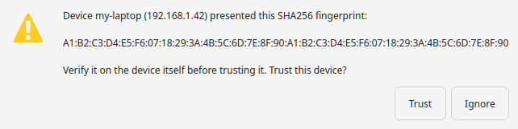
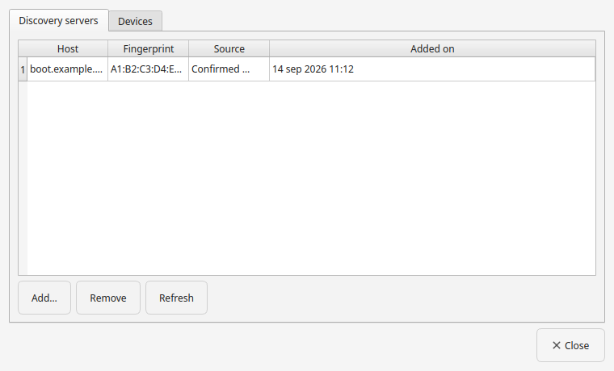

# Trust, fingerprints and identity checks

When HSYNC Desktop connects to another device, a discovery server or a sync
server, it first checks **that it is talking to the right one**. Each of them
proves its identity with a certificate, and the app remembers the "fingerprint" of
that certificate — a short code that uniquely names it. This page explains the
choices in plain language.

## What a fingerprint is, and why you are asked

A fingerprint is like a serial number for a device's identity: if it changes, the
app can no longer be sure it is the same machine you trusted before. So the first
time the app meets a device or server it may ask you to **trust** the fingerprint
it sees, and later it will warn you if the same name presents a *different* one.

Verifying a fingerprint **out of band** (reading it on the other device, in
person, or over a channel you trust) is what makes the trust meaningful. A changed
fingerprint is always treated as suspicious — possibly a man-in-the-middle — and is
never accepted silently.

## The prompts you may see

- **Pairing required** — strict pairing refused a device seen for the first time.
  Trust it (after checking the fingerprint) or ignore it.
- **Fingerprint changed** — a device you had trusted now presents a different
  fingerprint. You can trust the new one, **forget** the stored key, or ignore it.

Accepting pins the fingerprint in the shared store, so the app and the `hsync`
command line agree on what is trusted.

## Choosing how strict to be

The exact option names differ a little between the p2p and Server tabs, but the
idea is the same:

| Behaviour | What it means | Good for |
| --------- | ------------- | -------- |
| **Ask on first use** (default) | Trust the first fingerprint once you confirm it; refuse later changes. | Most people: one confirmation, then silence. |
| **Accept automatically** | Pin the first fingerprint with no question. | A closed, trusted network where you cannot be interrupted. |
| **Require the saved identity** | Only accept a fingerprint you have already pinned. | Strict setups: nothing new is trusted by chance. |
| **Don't verify** | Accept any fingerprint. | Never, unless you fully control the network. |

In **p2p Mode** the same idea applies to the device that becomes primary, through
**New primary device** (*Settings → p2p Mode*): **Ask for confirmation** by
default, **Accept automatically**, or **Require an explicit confirmation** (which
waits for you to pin the fingerprint with **Confirm a primary device…**).

The **discovery server** is optional, so its identity check never blocks a sync: if
it cannot be reached when a sync starts, the app warns you and keeps syncing on
the local network, and it stops using the server until you pin its fingerprint.
The **sync server** has no alternative path, so an unreachable or refused one keeps
the sync from starting.

## Where to review what is trusted

Open **Settings → p2p Mode → Manage trusted servers & devices…** (in Server Mode
the dialog shows the **Server HSYNC** store). It lists the discovery servers, sync
servers and devices whose fingerprints are stored, with the date they were added,
and lets you add or remove entries. There is no separate setting: this dialog
edits the same store the engine uses.

## Related

- [Choose how your devices connect](choose-connection.md) — server vs p2p.
- [Warnings and notifications](warnings.md) — the runtime security prompts.
- [Troubleshooting](troubleshooting.md) — when authentication fails.
