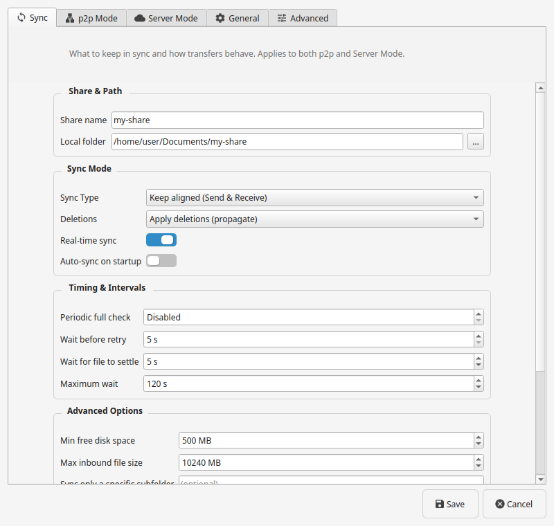
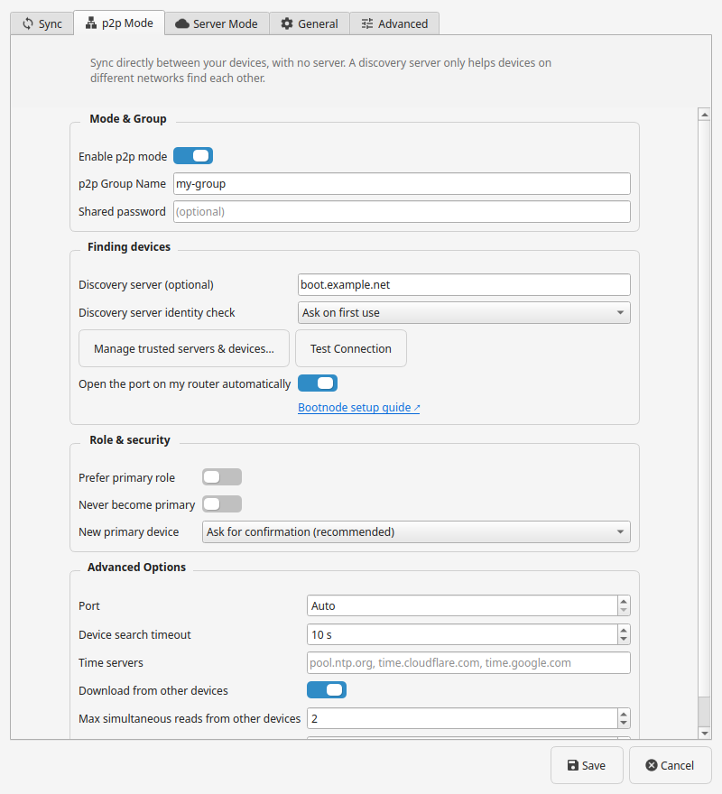
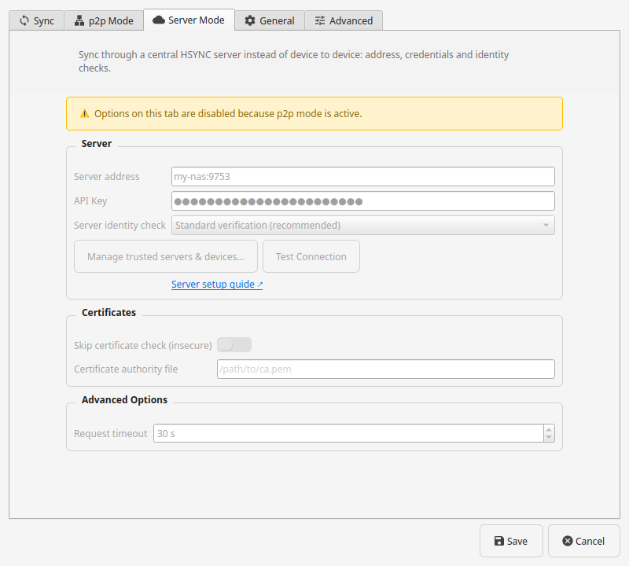
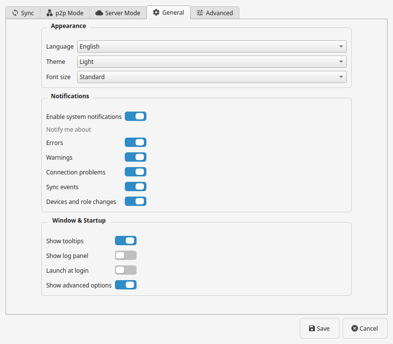
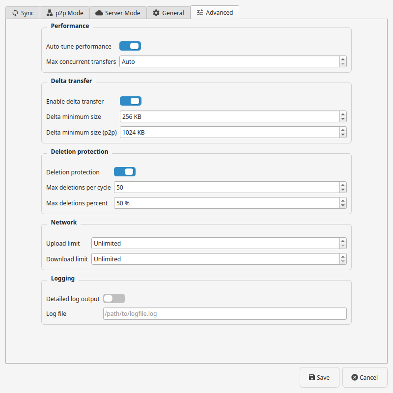

# Configuration Reference

Every HSYNC Desktop setting lives in the GUI **Settings** dialog and is persisted
with Qt `QSettings`. This page is the single source of truth for the settings.

- New to the app? Start from [Your first sync](first-sync.md) or the
  [Setup wizard](setup-wizard.md).
- Deciding between options? The dedicated guides —
  [Choose your sync type](choose-sync-type.md),
  [Choose what happens to deleted files](choose-deletion-policy.md),
  [Choose how your devices connect](choose-connection.md) and
  [Trust, fingerprints and identity checks](choose-trust.md) — explain the choice
  and link back here for the exact field.

Open **Settings** from the main window (or the tray menu). The dialog is organised
into five tabs: **Sync**, **p2p Mode**, **Server Mode**, **General** and
**Advanced**. The **Advanced** tab is hidden until you enable **Show advanced
options** in General; the same toggle also reveals the **Advanced Options**
sections in the other tabs, so the standard view stays uncluttered. Controls for
features your installed sync engine does not support are automatically disabled,
with a tooltip explaining why. Settings are read when a sync starts: while one runs
the connection-critical controls are disabled, and a change takes effect at the
next start. On a fresh install (no saved settings yet) the app starts in
**p2p Mode**.

## Sync

This tab holds the share name, local folder and compression toggle, plus the
transfer behaviour. It is used in both p2p and Server Mode.

| Setting | Description |
|---------|-------------|
| Share name | Name of the share: the folder name on the HSYNC server, or the share name in p2p mode. Devices that sync the same folder must use the **same share name** (and, in p2p, the same group name) |
| Sync Type | `Keep aligned (Send & Receive)`, `Send only (to other devices)` or `Receive only (from other devices)` — see [Choose your sync type](choose-sync-type.md) |
| Real-time sync | Keep syncing automatically as files change |
| Deletions | `Apply deletions (propagate)` keeps this device aligned: a file deleted on one device is deleted on the others. `Keep deleted files (backup)` never deletes here — local deletions are not sent and deletions from the other devices are not applied, so the folder only grows and a folder emptied elsewhere is left in place. It never deletes on the other devices either: a deletion recorded earlier cannot remove a file that still exists there. While it is active the main window shows a **Deletions kept** badge next to the status. Switching back to `Apply deletions` asks for confirmation first — see [Choose what happens to deleted files](choose-deletion-policy.md) |
| Auto-sync on startup | Start syncing as soon as the app launches. Off by default and never enabled for you: turn it on only if you want a run to begin on every launch. When the current settings could delete local files and the deletion-risk warning has not been acknowledged for this folder, when the one-time disclaimer has not been accepted yet, or when the plan the run computed includes deletions, the startup run stops and warns you instead of asking (and never opens a dialog) — press **Start** or **Preview changes** to review the plan and confirm it |
| Periodic full check | Run a full check every N seconds (minimum 20 s; **Disabled** turns it off) |
| Wait before retry | Delay before a failed transfer is retried (minimum 5 s) |
| Wait for file to settle | Ignore a file for this long while it is still being written |
| Maximum wait | Upper bound for the settle and timing waits (default 120 s, minimum 60 s) |
| Min free disk space | Refuse transfers below this free space |
| Max inbound file size | Refuse files larger than this |
| Sync only a specific subfolder | Restrict sync to a subfolder of the local folder |
| Simulation Mode | Preview changes without applying them: the run is a one-shot preview that stops after the summary, so nothing is transferred or deleted and the pre-start file-deletion confirmation is skipped. While it is on, the main window shows a **Simulation — no changes** badge and the title ends with **— Simulation** |
| Extra ignore patterns | Additional gitignore-style exclusion patterns |
| Ignore rules… | Edit the ignore patterns for the selected folder (stored as `.hsyncignore`) |

Large files are transferred with rsync-style delta blocks automatically by
default; delta transfer and its minimum sizes are tunable on the **Advanced** tab.

## p2p Mode

For peer-to-peer sync with no server. See the
[client p2p guide](https://github.com/albertsdk/hsync-client/blob/main/docs/p2p-mode.md)
for the underlying behaviour and [Choose how your devices connect](choose-connection.md)
for when to use it.

| Setting | Description |
|---------|-------------|
| p2p Group Name | Partition key for p2p rendezvous: devices only sync with other devices using the exact same group name. Leave it empty to put this device in the "no group" partition — it then syncs only with other devices that also left it empty |
| Shared password | Password shared by the devices in the p2p group; the client derives the group key from it (at least 12 characters), so the same password on every device yields the same key. A legacy raw group key (32+ characters) already stored by an older version keeps being used as-is — see [Secrets](secrets.md) |
| Discovery servers (optional) | Endpoint of an optional discovery servers (an HSYNC Rendezvous) for cross-network rendezvous (`host`, `host:port`, `[IPv6]`, `[IPv6]:port`); empty uses mDNS on the local network only. It only helps devices find each other and never carries or stores your files |
| Discovery servers identity check | How the app checks the discovery server's identity: ask on first use (default), accept automatically, require the saved identity, or don't verify — see [Trust, fingerprints and identity checks](choose-trust.md) |
| Manage trusted servers & devices | List, add and remove the discovery servers, server and device fingerprints the client actually uses |
| Open the port on my router automatically | Open the primary port so devices on other networks can connect to this one (only takes effect with a discovery server set) |
| Prefer primary role | Express a preference for the primary role. A device already serving as primary keeps the role |
| Never become primary | Remove this device from the primary election |
| New primary device | How this device trusts a primary it has never seen: **Ask for confirmation** (default: confirm the fingerprint on first contact, and refuse it when nothing can ask), **Accept automatically** (pin the first fingerprint silently) or **Require an explicit confirmation** (refuse it until you pin it). A changed fingerprint is always refused. **Confirm a primary device…** pins a fingerprint you read on that device, which is what **Require an explicit confirmation** waits for |
| Download from other devices | In p2p mode, fetch file blocks from other devices, not only the primary |
| Port | Fixed p2p listening port |
| Device search timeout | How long to wait for device rendezvous |
| Time servers | Comma-separated time servers (SNTP) for p2p clock-offset measurement; empty uses the built-in defaults. Entries may carry a port override, e.g. `ntp.local:123` |

The tab also holds **Enable p2p mode**, **Max simultaneous reads from other
devices** (1–32) and **Max devices per file** (1–8).

**Prefer primary role and sync type.** *Prefer primary role* is a preference, and
it only applies to the **Keep aligned (Send & Receive)** sync type, so the
conflict is caught as soon as it appears. Picking a one-way type (send-only or
receive-only) while p2p mode and *Prefer primary role* are both on offers to turn
it off because it is incompatible (accept jumps to the p2p tab); switching
*Prefer primary role* on while a one-way type is active offers to go back to the
**Keep aligned (Send & Receive)** type because they are incompatible (accept jumps
to the Sync tab). Declining either prompt keeps your choice and repeats the
generic warning when saving.

**Trust stores.** *Manage trusted servers & devices…* edits the client's
known-hosts (discovery servers and sync server) and known-devices stores directly —
there is no separate setting — so the GUI and the `hsync` CLI share the same
source of truth. The dialog shows only the stores relevant to the active mode: p2p
shows the rendezvous-server and device stores, Server Mode shows the **Server
HSYNC** store.

**Keyless runs.** Without a shared password the app confirms before starting:
devices are not authenticated and reads are open to anyone who can reach this
device. Set a shared password in the p2p tab to avoid the prompt; the confirmation
is requested on every start and is not a stored setting. See [Secrets](secrets.md).

**Test Connection.** *Test Connection* contacts the configured discovery server
and shows the certificate fingerprint it presents, which proves the address is
reachable; no pin is written. The button reads **Checking…** while the request
runs and the window stays responsive, so the result arrives in a dialog when the
server answers or the request times out.

## Server Mode

For syncing against a central HSYNC server.

The tab is grouped into **Server** (URL, API key, identity check and the
manage/test actions), **Certificates** (skip certificate check and CA file) and
**Advanced Options** (request timeout).

| Setting | Description |
|---------|-------------|
| Server address | Hostname, IP or `host:port` of the HSYNC server, e.g. `my-nas` or `my-nas:9753`; `https://` and port 9753 are implied. Leave empty for p2p only |
| API key | Account token (`hs_<id>_<secret>`); entered through a dedicated dialog (see [Secrets](secrets.md)) |
| Server identity check | How the app checks the server identity: standard verification (default), ask on first use, accept automatically, require the saved identity, or don't verify — see [Trust, fingerprints and identity checks](choose-trust.md) |
| Skip certificate check (insecure) | Disable TLS verification (trusted networks only) |
| Certificate authority file | Use a custom certificate file for a self-signed server |

The tab also holds **Request timeout** (seconds). *Test Connection* contacts the
server health endpoint and reports whether it answers; the button reads
**Checking…** while the request runs, so the window stays responsive until the
result appears.

## General

Application-wide preferences, grouped in three sections.

### Appearance

| Setting | Description |
|---------|-------------|
| Language | Interface language. **System default** (the default) follows the system locale; picking a language pins it |
| Theme | **System default** (follows the desktop and updates live), Light or Dark |
| Font size | Standard or **Slightly reduced** (every application font one point smaller, never below 8 pt) |

### Notifications

| Setting | Description |
|---------|-------------|
| Enable system notifications | Show desktop/system notifications for sync events. Errors and warnings are always shown in the app window; this setting only controls the OS notifications |
| Notifications for | Which events produce a system notification, one switch each: **Errors**, **Warnings**, **Connection problems**, **Synchronisation events**, **Devices and role changes**. Greyed out and inert while system notifications are off |

### Window & Startup

| Setting | Description |
|---------|-------------|
| Launch at login | Start HSYNC minimized to the tray when you log in |
| Show advanced options | Reveal the Advanced tab and the Advanced Options sections (off by default) |

**Show tooltips** and **Show log panel** toggle the option tooltips and the in-app
log viewer.

### Updates

| Setting | Description |
|---------|-------------|
| Check for updates at startup | Off by default. When on, the app asks the release page once a day whether a newer version exists. The switch sits in the two update dialogs (Help → Check for Updates… and the startup reminder), where the choice is relevant |

**Help → Check for Updates…** always works, whatever the setting: it asks the
GitHub release page for the newest published version and answers with either the
version you are running or the release you can download. The request needs no
account, carries no identifier and is the only outbound request the app makes to
a host other than your own sync server or peers.

The app never downloads or installs the update itself: **Download** opens the
release page, and the upgrade stays with the process your installation already
uses — `snap refresh`, the Windows installer, `apt`/`dnf`, or a manual replace of
the portable bundle. The startup reminder appears once per release; choosing not
to be reminded again for that version silences it until the next one.

Supported interface languages: English, Italian, German, Spanish, French,
Portuguese (Brazil), Chinese (Simplified), Russian, Dutch, Polish and Japanese.

The interface uses the desktop's configured **UI and monospace fonts** and follows
the system text scaling (GNOME/Ubuntu and KDE). The font-size choice applies
immediately; a desktop font/scale change is picked up on the next launch.

**Launch at login.** When enabled, the app registers a per-user autostart entry
that launches `hsync-desktop --minimized`, so the window stays in the tray at
login; disabling the option removes it. This is a desktop preference only: it
opens the app but does not start a sync (that is **Auto-sync on startup** on the
Sync tab).

## Advanced

Engine-level tuning and diagnostics. The tab is hidden until **Show advanced
options** is enabled in General. Changes apply at the next sync start.

| Setting | Description |
|---------|-------------|
| Auto-tune performance | Let the engine tune transfer concurrency, timeouts and retries |
| Max concurrent transfers | Ceiling on simultaneous transfers; **Auto** uses the engine default |
| Enable delta transfer | Transfer only changed blocks of large files |
| Delta minimum size | Minimum file size for delta transfer in server mode |
| Delta minimum size (p2p) | Minimum file size for delta transfer in p2p mode |
| Deletion protection | Pause a cycle that would delete too many local files (see below) |
| Max deletions per cycle | Number of deletions that trips the guard; 0 disables this rule |
| Max deletions percent | Percentage of local files whose deletion trips the guard; 0 disables this rule |
| Show the deletion-risk warning again | Bring back the warning silenced from its own dialog; it is scoped to the folder and settings you confirmed |
| Upload limit / Download limit | Bandwidth caps (1 MB/s = 1 MiB/s), enforced from the first byte and shared by all transfers of that direction; 0 (**Unlimited**) uses all available bandwidth |
| Detailed log output | Enable verbose (debug-level) logging. If the log panel is hidden and no log file is set, enabling it offers to show the panel |

**Log file** mirrors the same output to a file: the log panel keeps showing the
live log, and the file is a rotated copy of it. The panel also shows the app's
own lines (the ones with `[desktop]` where the engine puts its device id), which
the file does not contain — they describe the window, not the sync.

**Deletion protection.** When a cycle would delete more than the configured
threshold (absolute count or percentage of local files), those deletions are
skipped and the main window shows a warning, so a stray delete on one device
cannot wipe the folder. The sync itself keeps running and a later cycle retries
the deletions. Set either rule to 0 to disable it. See
[Warnings and notifications](warnings.md).

**Deletion-risk warning.** The pre-flight notice about **Receive only** can be
silenced with its own checkbox, for the folder and settings it was confirmed for.
**Show the deletion-risk warning again** clears that acknowledgement, so the next
start asks again; nothing else changes. See
[Warnings and notifications](warnings.md#warnings-before-a-sync).

**Bandwidth limits** are also editable from the status bar: click the
sent/received labels in the bottom-right of the main window. Both entry points
share the same values, and 0 means unlimited in both.

The action labels the log panel can show are listed in
[Log Labels](log-labels.md).

## Where settings are stored

Settings are persisted by Qt `QSettings`; secrets (API and p2p keys) are stored
encrypted with a machine-derived key and handed to the engine over a private
channel, never on the command line. See [Secrets](secrets.md).

The settings live in the per-user Qt location:

- Linux: `~/.config/HSYNC/HSYNCDesktop.conf`
- macOS: `~/Library/Preferences/com.HSYNC.HSYNCDesktop.plist`
- Windows: the `HSYNC\HSYNCDesktop` key under the current user in the registry

To start from scratch, quit the app and remove that entry: the next launch opens
the setup wizard again and asks for the keys. Your files, the `.hsyncignore`
rules and the folder's sync state are not touched (see
[FAQ — Where is the sync state stored](faq.md#where-is-the-sync-state-stored-and-can-i-delete-it-manually)).
