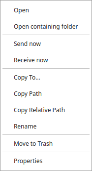

# The file list

The file list is the table in the middle of the main window. It shows exactly what
the sync works on, one row per file or folder, and it doubles as the way to open,
move and act on your files.

A name is never rewritten to make it fit. A file or folder whose name some
supported device cannot store — the characters `< > : " / \ | ? *`, a trailing dot
or space, a reserved name such as `CON` — is **not synchronised**: it stays on disk
and appears in the problems badge so you can rename it. The one exception is a
rename that changes only the capitalisation, which follows the destination's
spelling on a case-insensitive filesystem.

## Columns

Each row starts with an icon that carries the file type and, when the row has an
operation, its glyph: `↑` upload, `↓` download, `✕` a deleted row, `⇄` a rename.
The columns are:

| Column | Meaning |
| ------ | ------- |
| **Name** | The file or folder, with the icon above. Always shown, always first. Names appear exactly as they are on disk: spaces, punctuation, underscores and accented characters are never normalised for display. |
| **Size** | The size on disk. For a folder, the sum of the files it contains; its item count is shown in the tooltip and in the properties pane. |
| **Type** | The kind of file (hidden until you enable it). |
| **Modified** | The last modification date. |
| **Progress** | A bar with the percentage while a transfer runs. A file you are sending reaches 100% only once the other device has received it. |
| **Status** | The planned action ("To upload" / "To download" / …) or the result ("Syncing", "Synced"). |
| **Time left** | The estimated time left for a running transfer, once the rate is known (hidden until you enable it; blank until the first samples arrive). |
| **Speed** | The live transfer rate (hidden until you enable it). |

**Type**, **Time left** and **Speed** are hidden by default: the icon conveys the
type and the operation, and the two live metrics only say something while a
transfer runs. Turn them on from the header menu, which lists the columns in the
order you arranged them (**Name** stays first).
You can drag a divider to resize a column, drag a header to reorder the columns,
and double-click a divider to fit a column to its content. Widths, order and
visible columns are remembered across runs; **Reset columns** in the header menu
restores the default layout — order, visibility and fitted widths. An active sort
stays: it is a view choice, never persisted.

Files show their precise planned action, while a folder shows a neutral aggregate
("To sync") whose tooltip breaks down the mixed operations. A folder with no files
at all cannot aggregate anything, so it reports its own state instead: **Synced**
once every device holds it, **To upload** / **To download** while one side is
still missing it.

## Pending items

**Pending** in the list bar lists every file that still has work to do anywhere in
the share, one row per file with its path (for example `docs/report.pdf`). The
number on the button is the share's backlog.

The list is a view of the same table: the columns, the actions and the name filter
work as usual. Double-click a row to leave the list, open that file's folder and
select it — useful for a file that has not been downloaded yet. Leaving the list
(the button again, or opening a folder) restores the folder and the rows you had
selected.

## Search

The magnifier in the list bar (or `Ctrl+F`, `Cmd+F` on macOS) searches **this
folder and everything under it**: every file whose name or path contains what
you typed is listed with its path relative to the folder, so a match three
levels down needs no drilling. Capitalisation is ignored.

The results are the same table — the columns and the actions apply — and
double-clicking a result takes you to its folder with the row selected.
Clearing the field, closing it (the magnifier again, or `Esc` while it has focus),
or opening a folder returns to the browser. The search is a view: it changes
nothing on disk and is not remembered after a restart.

## Hidden files

Files and folders whose name starts with a dot are hidden from the list. Enable
**Show hidden files** from the header menu to see them — this changes only the
list, not what is synchronised.
