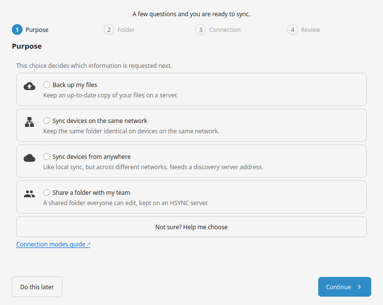
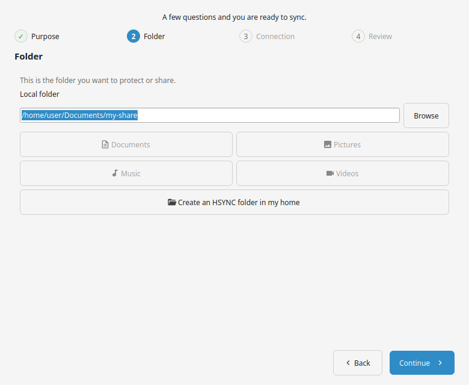
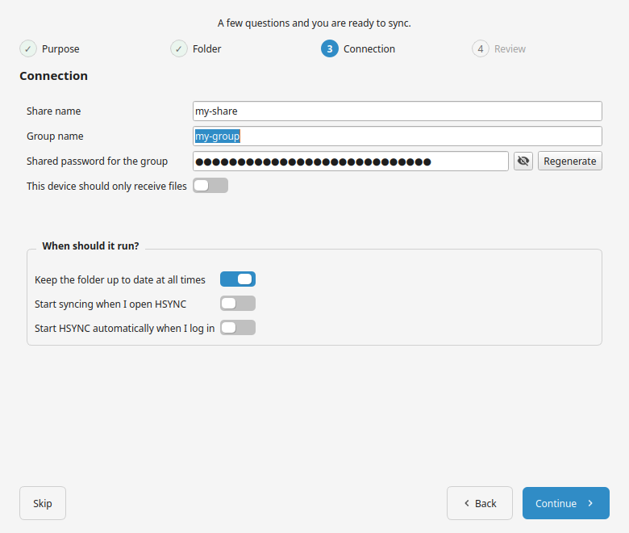
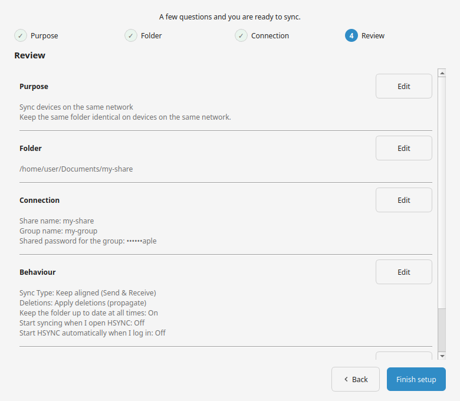
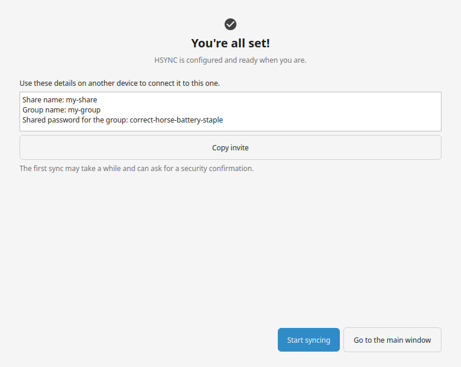

# Your first sync

This tutorial takes you from a freshly installed app to your first completed
sync. It follows the happy path once; the field-by-field detail of each screen is
in [Set up with the wizard](setup-wizard.md), and the full settings are in the
[Configuration Reference](configuration.md).

Before you start, install the app with one of the methods in
[Getting Started](getting-started.md) and open it once.

## 1. Open the setup wizard

On the very first launch, with no folder configured yet, the **Setup wizard**
opens by itself after the main window appears. If you closed it, open it again
from **Menu bar → Setup wizard**, from the tray menu, or by clicking the folder
placeholder in the main window.

## 2. Choose what you want to do

Pick the choice that matches you:

| Choice | Pick it when |
| ------ | ------------ |
| **Back up my files** | You want a copy of your files on a server. |
| **Sync devices on the same network** | Your devices share a Wi-Fi/LAN and need no server. |
| **Sync devices from anywhere** | Your devices are on different networks. |
| **Share a folder with my team** | Several people edit the same folder on a server. |

Not sure? Press **Help me choose** and answer a few short questions; the wizard
selects the right option for you. Still choosing between the two families?
[Choose how your devices connect](choose-connection.md) compares them.

## 3. Pick the folder

Choose the folder to protect or share. The suggestions use your own **Documents**,
**Pictures**, **Music** and **Videos** folders and show the free space. A folder
that does not exist, a file, or a system root is refused.

## 4. Enter the connection details

The fields depend on the choice you made in step 2:

- **Back up** / **Share** — the server address, the account key and the share
  name. Press **Test connection** once the address and key are in.
- **Same network** — a group name and a generated password.
- **From anywhere** — the group, the password and the address of a rendezvous
  server (a helper that lets your devices find each other across networks; it
  never stores your files).

For the two device-to-device choices, **This device should only receive files**
turns this computer into a receiver instead of a two-way peer.

The optional block below decides whether sync runs in real time, starts with the
app, and launches HSYNC when you log in; **Skip** keeps the defaults.

## 5. Review and finish

Check the summary (passwords are masked) and the verification result, use
**Edit** to change any step, then press **Finish setup**.

For a device-to-device setup, the success screen shows the **share name**,
**group name** and **shared password** under *Use these details on another device
to connect it to this one*. Copy those three values into the same fields on your
other computer — the invite can be copied with one click.

## 6. Start and watch

Press **Start** (or `Ctrl+Shift+S`). A confirmation shows the plan — how many
changes and how much data, with any deletions listed first. **Cancel** is the
default; press **Synchronize** to apply it.

You are done when the status bar reads **All files in sync**. Files in progress
show a percentage and a speed, and turn **Synced** when they are done.

## What you'll see

- `Connecting…`, then `Syncing…`, then `All files in sync` in the status bar.
- Rows filling in the file list as files move.
- In p2p Mode, a role appears once the devices have agreed who serves the files
  (see [Key concepts](concepts.md)).

## Where to go next

- [Start, watch and stop a sync](sync-basics.md) — the everyday controls.
- [Choose your sync type](choose-sync-type.md) — send-only, receive-only, or both.
- [Warnings and notifications](warnings.md) — what the prompts and badges mean.
