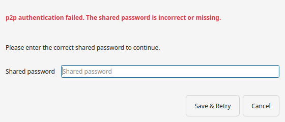

# Secrets and credentials

Your account key (Server Mode) and your shared group password (p2p Mode) are
secrets. The app treats them that way: you enter them through dedicated dialogs,
never on a command line, and they never appear in logs or process listings.



## How they are stored and used

- Entered in a **dedicated dialog** (see the p2p and Server tabs in
  [Settings](configuration.md)).
- Stored **encrypted on disk**, with a key derived from your machine.
- Handed to the sync engine over a **private channel**, so they are not visible as
  command-line arguments or in the log.
- Masked by default, with a **show/hide (eye) toggle** on the right of every
  secret field: reveal the value only on demand to check or copy it. The field is
  masked again the next time you open Settings.
- Replaceable at any time: reopen the dialog and enter a new value.

## p2p Mode: the shared password

The p2p password is what authorises changes in a group. The same password on every
device yields the same group key, so **every device in the group must use the exact
same string**.

- A **shared password** must be at least **12 characters**.
- A **raw group key** must be at least
  **32 characters**.

To generate a strong one on the command line (the one case where a terminal
helps):

```bash
openssl rand -hex 16
```

Copy the result to every device in the group.

### The discovery server uses the same password

If your devices find each other across networks, your setup may include a
**discovery server** (an *HSYNC Rendezvous*). Its operator can run it
**protected** — a *private* node, or a node that protects its buckets — and a
protected discovery server only introduces devices that know the group's key.

There is **no separate token to type**: the app derives the key automatically
from the **Shared password** in the p2p tab. The only thing that matters is
that the password matches the key the operator configured on the server:

- The password you enter here must be the **same one used when the server's key
  was created** (ideally the same password as the rest of the group).
- To get the exact value to give the server operator, use **Settings →
  p2p Mode → Finding devices → Show group key…** (the action only appears when
  a discovery server is configured): it opens a dialog where the whole
  `bucket=<key>` line stays **masked** until you reveal it with the eye icon,
  and the Copy button puts that line on the clipboard. There is no terminal
  involved — the app computes the key from your Shared password.
- Changing the **Shared password** later derives a different key, so the
  server's key file no longer matches: the app shows a warning under the
  password field and asks before applying, offering to show the new line.
- The operator should create that key from the shared password with
  `hsync derive-group-key` (the output is the same 64-hex key) — see the
  [client's cross-network guide](https://github.com/albertsdk/hsync-client/blob/main/docs/p2p-rendezvous.md).
- If the operator instead generated a random raw key (for example with
  `openssl rand -hex 32`), the desktop's password field cannot be made to match
  it: the field always treats what you type as a shared password. Ask the
  operator to reconfigure the server with a key derived from the password your
  devices use (or use **Show group key…** to prove the password's key to them).

If the password does not match, the app shows a warning that names
`token_required` — see
[Troubleshooting → The discovery server refuses the shared password](troubleshooting.md#the-discovery-server-refuses-the-shared-password-token_required).

## Server Mode: the account key

The server account key looks like `hs_<id>_<secret>`; it is issued by your HSYNC
server. Enter it in the Server tab's **API key** dialog.

## Keyless p2p runs

If the p2p password is empty, devices are **not authenticated** and reads are open
to anyone who can reach this device. The app warns you before starting and asks
you to confirm; setting a password stops the prompt. See
[Warnings and notifications](warnings.md#warnings-before-a-sync).

## Related

- [Trust, fingerprints and identity checks](choose-trust.md) — how devices prove
  who they are, beyond the password.
- [Configuration Reference](configuration.md) — the p2p and Server tabs.
