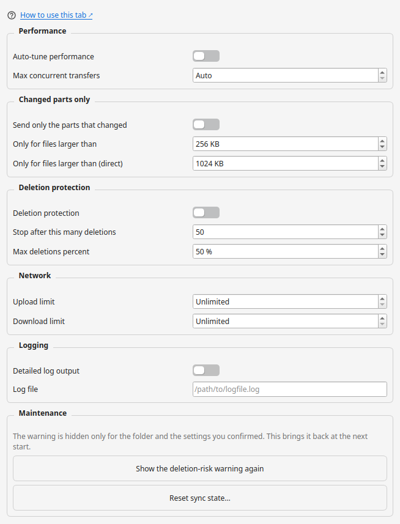
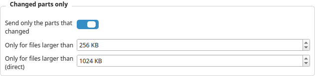
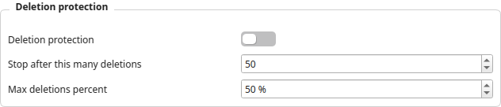

# The Advanced settings

The **Advanced** tab collects the engine-level tuning: performance, changed parts
only, deletion protection, bandwidth, logging and the maintenance actions. It is
hidden until **Show advanced options** is on in **General** — the same switch
reveals the advanced rows and groups of the other tabs, in place.

Open it with **Settings → Advanced**. Changes apply at the next sync start, not
while a run is in progress. This page follows the tab in the order the groups
appear: **Performance**, **Changed parts only**, **Deletion protection**,
**Network**, **Logging** and **Maintenance**.

## Performance

- **Auto-tune performance** — let the engine tune transfer concurrency, timeouts
  and retries to the environment. It is the right choice unless you are
  diagnosing a specific problem, and it is what makes the two fields below
  unnecessary in normal use.
- **Max concurrent transfers** — a hard ceiling on simultaneous file transfers.
  `Auto` uses the engine's tuned default; set a number when a weaker device or a
  metered link cannot take the tuned value.

## Changed parts only

- **Send only the parts that changed** — transfer only the changed blocks of
  large files (rsync-style) instead of the whole file. It is on by default and
  saves bandwidth on big files that change a little.
- **Only for files larger than** — the minimum size that uses changed-parts
  transfer in Server mode. Below it the whole file is sent, which is cheaper than
  the block comparison.
- **Only for files larger than (direct)** — the same threshold for Direct mode,
  which has its own default because peer transfers behave differently.

Lowering a threshold is not always a win: many small files make the block
comparison cost more than the transfer it saves.

## Deletion protection

When a cycle would delete more local files than the thresholds below, those
deletions are skipped and the main window shows a warning, so a stray delete on
one device cannot wipe the folder. The sync keeps running, and a later cycle
retries the deletions.

- **Deletion protection** — the switch that enables the guard.
- **Stop after this many deletions** — the number of deletions in one cycle that
  trips it; `0` disables this rule.
- **Max deletions percent** — the share of local files whose deletion trips it;
  `0` disables this rule.

Set both rules to `0` to disable the guard entirely.

## Network

- **Upload limit** and **Download limit** — bandwidth caps, enforced from the
  first byte and shared by every transfer of that direction. `0` (**Unlimited**)
  uses all the bandwidth available; the unit is MB/s, counted as MiB/s.
- The same values are reachable from the status bar: open **Details ▾** in the
  bottom-right corner of the main window (or click the sent/received values inside
  it). Both entry points write the same setting.

## Logging

- **Detailed log output** — verbose (debug-level) logging. If the log panel is
  hidden and no log file is set, enabling it offers to show the panel, so the
  output has somewhere to go.
- **Log file** — mirror the log to a file. The panel keeps showing the live log
  and the file is a rotated copy of it; the panel also shows the application's own
  lines (the ones with `[desktop]` where the engine puts its device id), which the
  file does not contain, because they describe the window, not the sync.

The action labels the log panel can show are listed in
[Log Labels](log-labels.md).

## Maintenance

Rare "undo/forget" operations. Neither is a tuning knob, so they live together
here.

- **Show the deletion-risk warning again** — the pre-flight notice about
  **Receive only** can be silenced from its own dialog, for the folder and
  settings you confirmed. This button clears that acknowledgement, so the next
  start asks again; nothing else changes. See
  [Warnings before a sync](warnings.md#warnings-before-a-sync).
- **Reset sync state…** — forget this folder's sync history so the next cycle
  rebuilds it. Your files are never touched; see
  [Reset the sync state](reset-sync-state.md).

## Where to go next

- [The General settings](settings-general.md) — `Show advanced options` and the
  preferences.
- [Warnings and notifications](warnings.md) — what the deletion warnings look
  like.
- [Troubleshooting](troubleshooting.md) — when a limit or a guard trips.
- [Configuration](configuration.md) — the four tabs and where settings are kept.
