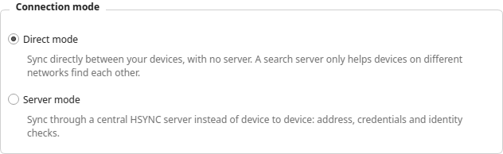
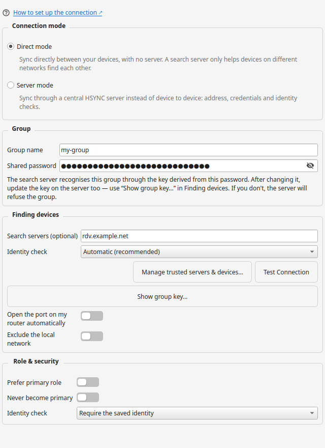
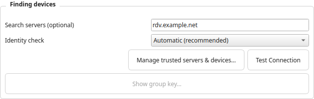
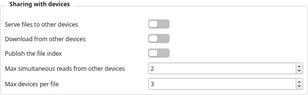
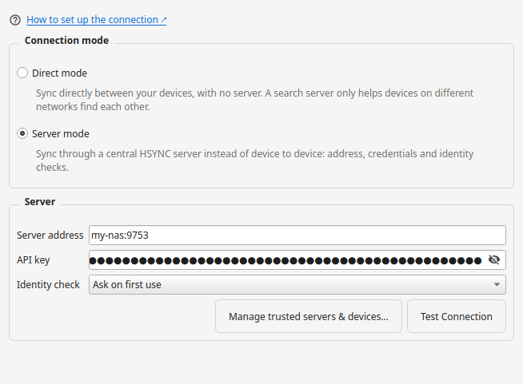
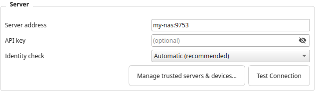
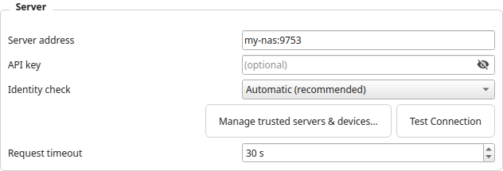

# The Connection settings

The **Connection** tab is where you say **how this device reaches the others**:
device to device with no server (**Direct mode**) or through a central **HSYNC
server** (**Server mode**). A setup uses one of them; switching later keeps every
value of the other, so nothing has to be typed again.

Open it with **Settings → Connection**. The page shows the groups of the selected
mode only, so it is never as tall as the two together, and only the selected mode
is checked when you press **Apply**: a value left in the other mode is validated
when you select it, so it never blocks a save you did not ask for. Settings are
read when a sync starts, and the controls that change the connection are disabled
while a run is in progress. Every field also has a tooltip.

This page follows the tab in the order the groups appear: **Connection mode**,
then the Direct mode groups — **Group**, **Finding devices**, **Role & security**,
**Advanced Options** — or the Server mode groups — **Server**, **Certificates**,
**Advanced Options**.

> Which mode is right for you is a different question:
> [Choose how your devices connect](choose-connection.md) compares the two in one
> table, and [Key concepts](concepts.md) defines the words used here.

## Connection mode

Two exclusive options, each with a sentence under it:

- **Direct mode** — sync directly between your devices, with no server. A search
  server only helps devices on different networks find each other.
- **Server mode** — sync through a central HSYNC server: address, credentials and
  identity checks.

On a fresh install the app starts in **Direct mode**. Picking the other option
shows its own groups in place of these, and nothing is lost.

### Direct mode · Group

A *group* is a partition of the devices in Direct mode: your devices sync only
with devices that use the **same group name**, and the shared password is what
authorises changes in it.

- **Group name** — leave it empty to put this device in the "no group" partition:
  it then syncs only with devices that also left it empty. Use the same name on
  every device of your group.
- **Shared password** — the password shared by the devices in the group (at least
  12 characters). The client derives the group key from it, so the same password
  on every device yields the same key, and a different one simply does not
  connect. A **protected search server** checks this same password: there is no
  separate token — see
  [Secrets → The search server uses the same password](secrets.md#the-search-server-uses-the-same-password).
  Generate one with `openssl rand -hex 16` and copy it to every device.
- A warning appears under the field when a search server is configured: changing
  the password derives a new key, so the server's key file must be updated too
  (use **Show group key…**). Without that the server refuses the group, and
  **Apply** asks before going ahead.

Without a shared password the app asks for confirmation before every start:
devices are not authenticated and reads are open to anyone who can reach this
one.

### Direct mode · Finding devices

This is where devices on **different networks** are told how to find each other.
Nothing here carries or stores your files.

- **Search servers (optional)** — the address of one or more search servers (an
  HSYNC Rendezvous): `host`, `host:port`, `[IPv6]` or `[IPv6]:port`, several
  separated by commas. Every reachable server is used and the results merged.
  Leave it empty to find devices on the local network only (mDNS). If the server
  is *protected*, it checks the group key derived from the **Shared password**,
  so that password must match what the server expects.
- **Identity check** — how the app checks the search server's identity before
  trusting it: `Ask on first use` (default: you confirm the fingerprint once),
  `Accept automatically`, `Require the saved identity`, or `Don't verify
  (insecure)`. See [Trust, fingerprints and identity checks](choose-trust.md).
- **Connection to the search server** — `Automatic (recommended)` races the fast
  UDP path and the compatible TCP one; `Fast only (UDP)` and `Compatible only
  (TCP)` pin one transport. Pick `Compatible only (TCP)` when the network filters
  UDP.
- **Manage trusted servers & devices** — list, add and remove the search servers,
  the server and the device fingerprints the client actually uses. This is the
  same store the `hsync` command line uses, so the two never disagree.
- **Test Connection** — contacts the configured search servers and shows the
  certificate fingerprint they present. It proves the address is reachable and
  writes no pin. The button reads **Checking…** while the request runs and the
  answer arrives in a dialog.
- **Show group key…** — appears while a search server is set. It reveals the
  masked line to add to the server's key file, so the server recognises this
  group; see
  [Secrets → The search server uses the same password](secrets.md#the-search-server-uses-the-same-password).
- **Open the port on my router automatically** — ask the router (UPnP) to open
  the listening port so other networks can reach this device. It only takes
  effect with a search server set.
- **Exclude the local network** — find devices only through the search servers,
  ignoring the local network (mDNS). Useful on a shared network or when the local
  interface is a VPN; it requires a search server.

### Direct mode · Role & security

In a group, one device is the **primary** (it serves the files) and the others are
**secondary**. See [Key concepts](concepts.md#primary-and-secondary-role-direct-mode).

- **Prefer primary role** — a preference, not a guarantee: a device that is
  already serving as primary keeps the role. It only applies to the **Keep
  aligned (Send & Receive)** sync direction, so the app offers to fix the
  incompatibility as soon as you combine the two.
- **Never become primary** — removes this device from the primary election; it
  always stays secondary.
- **Identity check** — how this device trusts a primary it has never seen:
  `Ask on first use` (default: confirm the fingerprint on first contact and refuse
  it when nothing can ask), `Accept automatically` (pin the first fingerprint
  silently) or `Require the saved identity` (refuse until you pin it). A changed
  fingerprint is always refused. Pins are reviewed under **Manage trusted
  servers & devices**.

### Direct mode · Advanced Options

These groups appear only when **Show advanced options** is on in **General**.
Leave the defaults unless you know what you are changing.

- **Port** — the fixed listening port in Direct mode (`0` = automatic).
- **Device search timeout** — how long to wait for device discovery.
- **Time servers** — comma-separated SNTP servers used to measure the clock offset
  between devices. Empty uses **no public time servers**: the reference is the
  server/master (on a slave the trusted master has precedence); configure this
  only when you need a specific source (e.g. an internal NTP). An entry may carry
  a port (`ntp.local:123`).
- **Serve files to other devices** — serve file blocks to the other devices, so
  they can skip the primary.
- **Download from other devices** — fetch file blocks from the other devices, not
  only from the primary.
- **Publish the file index** — tell the primary what this device already holds, so
  it can show what is up to date.
- **Max simultaneous reads from other devices** — 1 to 32.
- **Max devices per file** — 1 to 8.

### Server mode · Server

- **Server address** — hostname, IP or `host:port` of the HSYNC server, e.g.
  `my-nas` or `my-nas:9753`: `https://` and port 9753 are implied. Leave it empty
  to use Direct mode only.
- **API key** — the account token (`hs_<id>_<secret>`), entered through a
  dedicated dialog and stored encrypted; see [Secrets](secrets.md).
- **Identity check** — how the app checks the server's identity: `Check the
  server's identity (recommended)` (standard certificate verification),
  `Ask on first use`, `Accept automatically`, `Require the saved identity` or
  `Don't check (not recommended)`. See
  [Trust, fingerprints and identity checks](choose-trust.md).
- **Manage trusted servers & devices** — the **Server HSYNC** store: the
  fingerprints this device trusts.
- **Test Connection** — contacts the server's health endpoint and reports whether
  it answers. It writes no pin and sends no credentials.

**What happens when you save.** Changing the share name or the API key makes the
app ask the server about the share before saving. When the server says the share
does not exist, or that your account cannot access it, you can **create the share
on the server**, save without creating it, or cancel. A share is never created
implicitly: the first sync lists the remote files before uploading anything, so a
share that does not exist stops the run instead of being created. When the account
already owns as many shares as the server allows, the app names the limit and asks
you to delete one or raise it. To use a share owned by somebody else, ask its
owner (or the server administrator) to add you as a member; without a membership
the server answers *not found* for a share that exists. See
[Roles and Permissions](https://github.com/albertsdk/hsync-server/blob/main/docs/roles-and-permissions.md)
for the server side of this.

Saving a preference that is not about the connection (the language, the theme, a
sync interval) never contacts the server: only an edited connection is checked, so
a rejected key or an unreachable host cannot block the rest of the settings.

### Server mode · Certificates

A fresh server answers with a **self-signed certificate** unless you installed a
real one. Two options cover that:

- **Skip certificate check (insecure)** — stop verifying TLS. It removes the
  protection against a machine impersonating the server: keep it for a trusted
  network only, and prefer pinning the identity above.
- **Certificate authority file** — point the app at the certificate file the
  server uses, so its chain verifies normally. This is the clean choice for a
  self-signed server on a network you control.

### Server mode · Advanced Options

Appears only when **Show advanced options** is on in **General**.

- **Request timeout** — how long to wait for one HTTP request to the server, in
  seconds. Raise it on a slow or high-latency link.

## Common mistakes

- **The API key is refused but the address is right.** The key must belong to the
  server administrator or to a member of that share. A share owned by another
  account answers *not found* until you are added as a member.
- **`Test Connection` succeeds and the sync still fails.** The test only proves
  the endpoint answers. A rejected key, a missing share or a certificate the sync
  refuses (see **Identity check**) show up on the first run instead.
- **Devices on the same network are found, the remote one is not.** In Direct
  mode that is a search server problem: check **Search servers** above, then
  [Troubleshooting → Devices are not found in Direct mode](troubleshooting.md#devices-are-not-found-in-direct-mode).
- **The search server refuses the group after a password change.** Update the
  server's key file with the new **Show group key…** line, or restore the old
  password.

## Where to go next

- [The Sync settings](settings-sync.md) — the folder, the direction and the
  deletions.
- [Choose how your devices connect](choose-connection.md) — if you are still
  choosing between the two modes.
- [Configuration](configuration.md) — the four tabs and where settings are kept.
