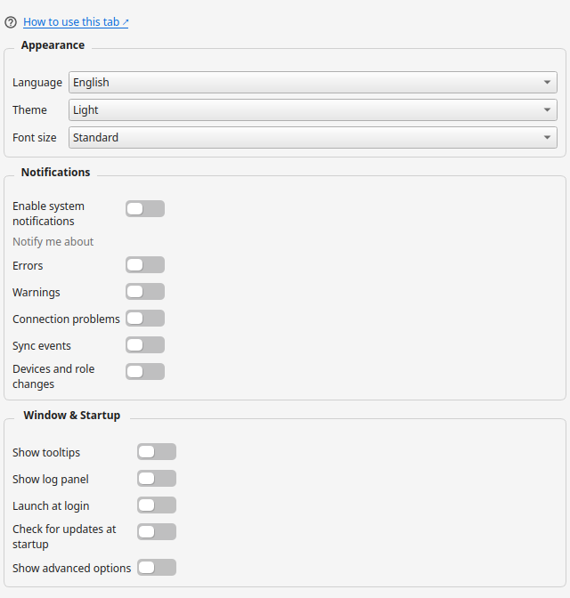
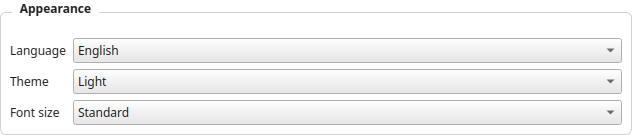
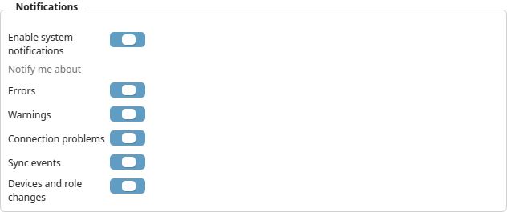
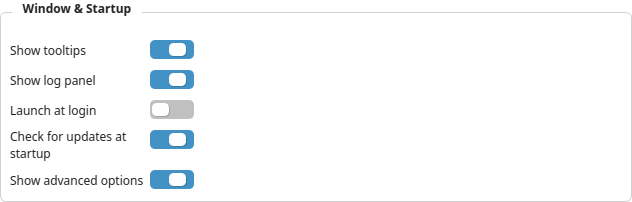

# The General settings

The **General** tab holds the preferences that are about the application, not
about a share: the language, the theme, the notifications and how the window
starts. They apply to this installation, not to the other devices.

Open it with **Settings → General**. This page follows the tab in the order the
groups appear: **Appearance**, **Notifications** and **Window & Startup**.

## Appearance

- **Language** — the interface language. `System default` (the default) follows
  the system locale; picking a language pins it, whatever the system says.
- **Theme** — `System default` (follows the desktop and updates live), `Light` or
  `Dark`.
- **Font size** — `Standard` or `Slightly reduced`, which makes every application
  font one point smaller and never below 8 pt. It applies immediately.

The interface uses the desktop's configured UI and monospace fonts and follows
the system text scaling; a desktop font or scale change is picked up on the next
launch.

## Notifications

- **Enable system notifications** — show desktop notifications for sync events.
  Errors and warnings always appear in the application window; this switch only
  controls the notifications of the operating system.
- **Notify me about** — one switch per event: **Errors**, **Warnings**,
  **Connection problems**, **Sync events**, **Devices and role changes**. They are
  greyed out and inert while system notifications are off, and the choice is kept
  for when you turn them back on.

What each event looks like in the window is described in
[Warnings and notifications](warnings.md).

## Window & Startup

- **Show tooltips** — show or hide the tooltips on the settings options. Turning
  them off does not change any value; it only hides the explanations.
- **Show log panel** — show the log panel in the main window. The panel keeps the
  last 10 000 lines, which is where you look first when something does not work
  (see [Where are the logs?](troubleshooting.md#where-are-the-logs)).
- **Launch at login** — start HSYNC minimized to the tray when you log in. This
  registers a per-user autostart entry that runs `hsync-desktop --minimized`, and
  turning the option off removes it. It is a desktop preference only: it opens
  the app, it does not start a sync — that is **Auto-sync on startup** in
  [the Sync settings](settings-sync.md).
- **Check for updates at startup** — off by default. When on, the app asks the
  release page once a day whether a newer version exists. **Help → Check for
  Updates…** works whatever the setting. Nothing is downloaded or installed: the
  update stays with the process your installation already uses.
- **Show advanced options** — reveal the **Advanced** tab and the **Advanced
  Options** groups in the other tabs. It is off by default, so the standard view
  stays short; the choice is a preference, so it survives a restart.

## Where to go next

- [The Sync settings](settings-sync.md) — the folder and how it is synchronized.
- [The Advanced settings](settings-advanced.md) — performance, bandwidth and
  logging.
- [Configuration](configuration.md) — the four tabs and where settings are kept.
