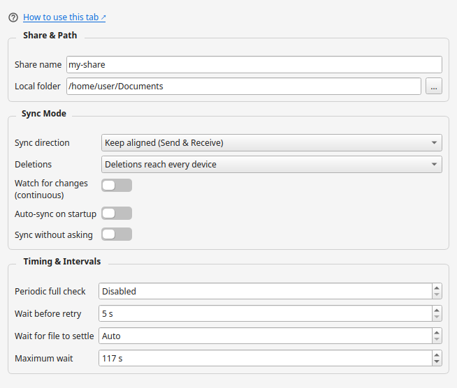
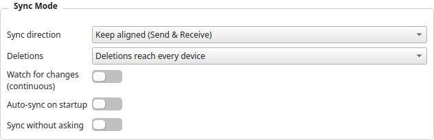
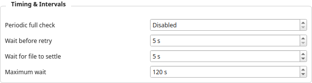

# The Sync settings

The **Sync** tab holds the shared folder and how it is synchronized. It is the
same in Direct mode and in Server mode, so you fill it once.

Open it with **Settings → Sync** (from the menu bar or the tray menu). Settings
are read when a sync starts: **Apply** saves them, and a run that is already in
progress keeps the values it started with. While a sync runs, the controls that
would change the connection are disabled. Every field also has a tooltip — if
you see none, turn **Show tooltips** on in **General**.

This page follows the tab in the order the groups appear: **Share & Path**,
**Sync Mode**, **Timing & Intervals** and **Advanced Options** (the last one
appears only when **Show advanced options** is on).

## Share & Path

- **Share name** — the name of the folder as the other devices and the server
  see it. Devices that sync the same folder must use the **same share name**
  (and, in Direct mode, the same group name). In Server mode it is the share on
  the server; changing it never changes your API key. Leave it as it is unless
  you are creating a new share — see [Managing multiple shares](shares.md).
- **Local folder** — the folder on this computer; pick it with **Browse**. One
  folder belongs to one share, so a folder another share already uses is
  refused. See [one folder per share](shares.md#one-folder-per-share).

## Sync Mode

- **Sync direction** — `Keep aligned (Send & Receive)`, `Send only (to other
  devices)` or `Receive only (from other devices)`. Pick `Keep aligned` when both
  sides change files. See [Choose your sync direction](choose-sync-direction.md).
- **Deletions** — `Deletions reach every device` keeps this device aligned: a
  file deleted on one device is deleted on the others. `Never delete files on
  this device` never deletes here and never applies a deletion from elsewhere, so
  the folder only grows. While it is active the window shows a **Deletions kept**
  badge. Switching back asks for confirmation first — see
  [Choose what happens to deleted files](choose-deletion-policy.md).
- **Watch for changes (continuous)** — keep syncing as files change instead of
  only when you press **Start**. Turn it off if a run should start only on
  request.
- **Auto-sync on startup** — start a run when the app launches. It is off by
  default and never enabled for you. A startup run that could delete local files,
  or whose plan contains deletions, stops and warns instead of running: press
  **Start** or **Compare** to review the plan.
- **Sync without asking** — apply the plan without the confirmation dialog when
  it only transfers or renames files. A plan that deletes anything still asks,
  and **Compare** always shows the plan.

## Timing & Intervals

The defaults suit a normal desktop; change these only when a specific problem
tells you to.

- **Periodic full check** — run a complete check every N seconds (`Disabled`
  turns it off; the minimum is 20 s). A full check catches what a file watcher
  cannot see, at the cost of one scan.
- **Wait before retry** — how long to wait before retrying a failed transfer
  (minimum 5 s).
- **Wait for file to settle** — ignore a file for this long while it is still
  being written, so a half-written file is not transferred. `Auto` lets the
  engine decide.
- **Maximum wait** — upper bound for the settle and timing waits (default 120 s,
  minimum 60 s).

## Advanced Options

This group appears only when **Show advanced options** is on in **General**.

- **Min free disk space** — refuse transfers that would leave less free space
  than this. `Disabled` turns the check off.
- **Max inbound file size** — refuse files larger than this.
- **Sync only a specific subfolder** — restrict the sync to one subfolder of the
  local folder. Leave it empty to sync the whole folder.
- **Enable compression** — compress the transfer stream. Turn it off when the
  files are already compressed (photos, videos, archives) and the CPU cost is not
  worth it.
- **Simulation Mode** — every run only shows the preview: nothing is transferred
  or deleted, and the window shows a **Simulation — no changes** badge. Useful to
  see what a change would do before trusting it.
- **Extra ignore patterns** — gitignore-style patterns excluded from the sync, in
  addition to the folder's `.hsyncignore`.
- **Ignore rules…** — edit the patterns for the selected folder; they are stored
  in its `.hsyncignore`. The syntax and the common cases are in
  [Ignore files you do not want to sync](ignore-rules.md).
- **Reset sync state…** — forget this folder's sync history so the next cycle
  rebuilds it. Your files are never touched; see
  [Reset the sync state](reset-sync-state.md).

## Where to go next

- [The Connection settings](settings-connection.md) — how this device reaches
  the others.
- [Key concepts](concepts.md) — share, primary, search server, conflict copy.
- [Configuration](configuration.md) — the four tabs and where settings are kept.
