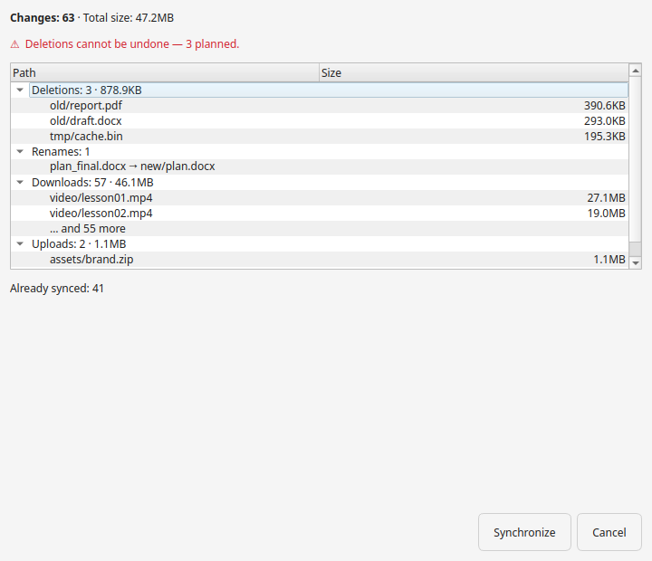

# Start, watch and stop a sync

This page covers the everyday controls: opening the app, starting a sync, watching
it, checking for changes and syncing a single folder on demand. The settings
behind these actions live in the [Configuration Reference](configuration.md).

## Start the app

```bash
hsync-desktop
```

Bundles and AppImages run the file you downloaded; from a clone, `./run.sh`
creates the virtual environment and launches the app.

Closing the window hides it to the tray and a running sync keeps going — use the
tray menu to show the window again. **Quit** stops the sync and asks for
confirmation while one is running; without a system tray the window really closes
(it asks the same confirmation) and the app exits. Launching the app again never
opens a second window: it brings the existing one forward.

Run `hsync-desktop --minimized` to start straight into the tray without showing
the window (with no tray available it shows the window instead). Enable **Launch
at login** in *Settings → General* to do this automatically at login. The welcome
splash appears only on the first launch.

## Start a sync

1. Press **Start** — the ▶ button, **Menu bar → Sync → Start**, or `Ctrl+Shift+S`.
2. A confirmation opens showing the plan: how many changes it holds and how much
   data it moves, the scope and the sync type when they are not the default, and
   the plan grouped by action — **deletions first**, then renames, then the
   downloads and uploads largest-first. The deletions are stated before you
   confirm, with an estimate of the transfer time at the bandwidth limit you set
   (no limit, no estimate — the number is never invented). If the plan would trip
   the mass-deletion guard, the dialog says those deletions will be paused.
   **Cancel** is the default button: only **Synchronize** applies the plan.
3. The sync runs until you stop it.



The first time you start a sync, the app shows a liability disclaimer: choose
**I understand** to continue, or **Not now** to close it without starting. Check
**Don't show this message again** to stop asking; the app prompts again only when
the disclaimer text changes.

**Simulation Mode** (Settings → Sync) turns the run into a preview: it stops at
the summary and transfers or deletes nothing. While it is on, the main window
shows a **Simulation — no changes** badge next to the connection status, the
title bar ends with **— Simulation**, the Start tooltip says the run only
previews, and every run opens with `--- Simulation: no changes will be applied ---`
in the log. The summary dialog's only action is **Close**.

With **Keep deleted files** selected (Settings → Sync → Deletions) the status bar
shows a **Deletions kept** badge for as long as the policy is active. Click the
badge (or open Settings) to switch to **Apply deletions**; the change is confirmed
first. See [Choose what happens to deleted files](choose-deletion-policy.md).

## Watch progress

- The action bar shows the **share name** next to the folder icon; click it to open
  the shared folder in your file manager, and hover it to see the local path.
- A file you are receiving appears in the list while it is still being written,
  with its percentage and rate, and shows its real size once complete. The same
  happens for the files this app **serves** when it is the device the others sync
  from: they show as sending, with their percentage, and turn **Synced** once the
  peer has them.
- The bottom-right sent/received numbers are the **distinct files** moved this
  session (a file transferred or renamed more than once still counts once); the
  size in parentheses is the total bytes moved, repeats included.
- The **Log** panel shows the engine's own messages; the labels are in
  [Log Labels](log-labels.md).
- With **Real-time sync** enabled, the app keeps running and re-syncs on changes
  until you stop it.

The status bar also answers **are the files in sync?** — the states are described
in [Warnings and notifications](warnings.md#is-everything-in-sync).

The file list itself is described in [The file list](file-list.md).

## Check for changes

**Check for changes** (`F5`, or the magnifier button in the action bar) re-compares
the folder with the other devices.

- On a **secondary** device it lists the changes still pending and asks whether to
  sync them.
- On the **primary** device it only re-reads what the connected devices hold — the
  primary is the source, so it has nothing to pull — and updates the file list and
  the *are the files in sync?* label.

The action is available for as long as the sync is running, in both roles.

## Sync one folder on demand

To sync a single folder without a full run, right-click it (or use the **File**
menu) and choose:

- **Send now** — push it to the other devices.
- **Receive now** — pull it from them.

Both run a one-shot scoped to that folder — or, for a file, to its containing
folder — and are available only while no sync is running. While the one-shot runs
a toast shows what it is doing; when it ends the result is reported once (a
summary dialog in the foreground, a desktop notification otherwise), including
"already up to date", no other device found, or the server unreachable. The file
list stays in the folder you were browsing, with the entry you acted on still
selected.

When two devices really change the same file at once, the merge keeps one version
and preserves the other next to it as a conflict copy (`_conflicted_copy_`), so
nothing is lost; the log names the file. The rules behind it are the client's
[conflict resolution](https://github.com/albertsdk/hsync-client/blob/main/docs/conflict-resolution.md).

## Keyboard shortcuts

| Shortcut | Action |
| --- | --- |
| `Ctrl+O`, `Enter` | Open the selected file or folder |
| `F2` | Rename |
| `Delete` | Move to trash |
| `Alt+Enter` | Properties |
| `Ctrl+Shift+C` | Copy path |
| `Ctrl+Alt+C` | Copy to a folder |
| `F5` | Check for changes: refresh the file list and the sync state |
| `Ctrl+Shift+S` | Start |
| `Ctrl+,` | Settings |
| `F1` | Documentation |
| `Ctrl+Q` | Quit |

On macOS `Cmd` replaces `Ctrl` (`Cmd+,` for Settings, `Cmd+Q` to quit). The log
panel uses the standard `Ctrl+C` / `Ctrl+A` for copying and selecting its text.

## Where to go next

- [Warnings and notifications](warnings.md) — what the prompts and badges mean.
- [The file list](file-list.md) — columns, the right-click menu, hidden files.
- [Troubleshooting](troubleshooting.md) — when a sync does not start.
