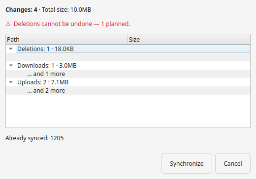

# Start, watch and stop a sync

This page covers the everyday controls: opening the app, starting a sync, watching
it, checking for changes and syncing a single folder on demand. The settings
behind these actions live in [The Sync settings](settings-sync.md).

## Start the app

```bash
hsync-desktop
```

Bundles and AppImages run the file you downloaded; from a clone, `./run.sh`
creates the virtual environment and launches the app.

Closing the window hides it to the tray and a running sync keeps going — use the
tray menu to show the window again. **Quit** stops the sync and asks for
confirmation while one is running; without a system tray the window really closes
(it asks the same confirmation) and the app exits. Launching the app again never
opens a second window: it brings the existing one forward.

Run `hsync-desktop --minimized` to start straight into the tray without showing
the window (with no tray available it shows the window instead). Enable **Launch
at login** in *Settings → General* to do this automatically at login. The welcome
splash appears only on the first launch.

## Start a sync

1. Press **Start** — the ▶ button, **Menu bar → Sync → Start**, or `Ctrl+Shift+S`.
2. A confirmation opens showing the plan: how many changes it holds and how much
   data it moves, the scope and the sync type when they are not the default, and
   the plan grouped by action — **deletions first**, then renames, then the
   downloads and uploads largest-first. The deletions are stated before you
   confirm, with an estimate of the transfer time at the bandwidth limit you set
   (no limit, no estimate — the number is never invented), and with how long they
   stay restorable in the trash (`HSYNC_TRASH_RETENTION_DAYS`, 30 days by
   default; with the trash off the warning says they cannot be undone). If the
   plan would trip the mass-deletion guard, the dialog says those deletions will
   be paused. **Cancel** is the default button: only **Synchronize** applies the
   plan.
3. The sync runs until you stop it. **Stop** asks for confirmation while a run is
   in progress: the transfers in flight are abandoned (a partial upload resumes on
   the next run, a partial download is fetched again), so the click must be
   deliberate. Choosing **No** leaves the run untouched.



The first time you start a sync, the app shows a liability disclaimer: choose
**I understand** to continue, or **Not now** to close it without starting. Check
**Don't show this message again** to stop asking; the app prompts again only when
the disclaimer text changes.

With **Apply changes that delete nothing** (Settings → Sync, on by default) a plan
that transfers or renames files but deletes nothing is applied without the
confirmation dialog. The first plan of the installation is always shown, a plan
with any deletion still asks, and **Compare** always shows the plan: that entry
point exists to review it.

## Restore a deleted file

**Sync → Trash…** lists the files this device deleted, newest first, with when
and how large they were. Select one and press **Restore**: the file goes back
into the folder and the next sync propagates it to every device. **Empty trash**
deletes the stored copies for good, after a confirmation.

The list comes from the client's own store (`hsync trash list`), so it opens
while a sync runs; the files are kept for the client's retention window (30 days
by default). A restore refuses when the path already exists in the folder, and in
a **Receive only** folder — the mirror rule would delete the file again.

**Simulation Mode** (Settings → Sync) turns the run into a preview: it stops at
the summary and transfers or deletes nothing. While it is on, the main window
shows a **Simulation — no changes** badge next to the connection status, the
title bar ends with **— Simulation**, the Start tooltip says the run only
previews, and every run opens with `--- Simulation: no changes will be applied ---`
in the log. The summary dialog's only action is **Close**.

With **Never delete files on this device** selected (Settings → Sync → Deletions) the status bar
shows a **Deletions kept** badge for as long as the policy is active. Click the
badge (or open Settings) to switch to **Deletions reach every device**; the change is confirmed
first. See [Choose what happens to deleted files](choose-deletion-policy.md).

## Compare

**Compare** is the app's one way to ask *what would be synced?* It answers
whether or not a sync is running: **F5**, `Ctrl+Shift+P`, the refresh button in the
action bar, `Sync → Compare` in the menu bar, the tray entry, or a click on
the pending-changes text in the status bar.

**While no sync is running** the app starts a preview run:

1. The window shows **Preparing the plan…** with a progress toast and a matching
   line in the log, so the wait is never silent.
2. The same plan confirmation a Start would show opens, with **Close** as the
   default button and **Sync now** next to it.
3. **Close** (or `Esc`) applies nothing and ends the run. **Sync now** applies the
   plan in the session that computed it — no second connection and no new
   comparison, so what you saw is exactly what runs.

Compare goes through the same checks as Start (disclaimer, deletion
risk, keyless Direct mode warning, free disk space, server/device trust): those protect
the connection, not the decision to apply. **Start** itself is unchanged — it
still shows the plan and asks for **Synchronize** first; its tooltip says so.

**While a sync is running** the same action compares the folder with the other
devices over the live connection:

- On a **secondary** device it lists the changes still pending and asks whether to
  sync them.
- On the **primary** device it only re-reads what the connected devices hold — the
  primary is the source, so it has nothing to pull — and updates the file list and
  the *are the files in sync?* label.

The app also compares on its own when it connects and when devices or files
change, so the action is a fallback: its tooltip shows how the click answers in the
current state and when the folder was last compared. While a comparison runs the
control is disabled — one full scan at a time, and the tooltip reads **Checking…**.
Pressing it before a connection exists scans nothing: the window says that the
comparison starts automatically as soon as a device is reachable, and a run with no
other device reports **No devices** instead of claiming that everything is in sync.

An **automatic** start (auto-sync on startup or launch at login) never opens a
dialog: it applies the plan when the plan deletes nothing — reported in the log
and, while the window sits in the tray, by a desktop notification — and stops
with a warning when the plan includes deletions, so you can review it with
Compare or Start. If the app has to ask you for a password again after
an authentication failure, the next plan is shown for confirmation instead of
being applied. In Simulation Mode the plan is only ever shown.

## Watch progress

- The action bar shows the **share name** next to the folder icon; click it to open
  the shared folder in your file manager, and hover it to see the local path.
- A file you are receiving appears in the list while it is still being written,
  with its percentage and rate, and shows its real size once complete. The same
  happens for the files this app **serves** when it is the device the others sync
  from: they show as sending, with their percentage, and turn **Synced** once the
  peer has them. A row that stops reporting is re-checked on its own until it
  resolves: it never stays in flight forever.
- If the link drops, the summary says so — **Offline — last known state** — and the
  file rows keep the last status they reached: the comparison is stale, not wrong,
  so a synced file never looks unsynced. The app reconnects on its own and the
  state returns to "Checking…" when the link is back; a run that cannot reach the
  peer reports the cause once instead of repeating it on every attempt. When this
  app is the **primary** the others sync from, having no device connected between
  syncs is normal: the summary keeps the last known state and does not switch to
  Offline.
- The bottom-right sent/received numbers are the **distinct files** moved this
  session (a file transferred or renamed more than once still counts once); the
  size in parentheses is the total bytes moved, repeats included.
- The **Log** panel shows the engine's own messages; the labels are in
  [Log Labels](log-labels.md).
- With **Watch for changes (continuous)** enabled, the app keeps running and
  re-syncs on changes until you stop it.

The status bar also answers **are the files in sync?** — the states are described
in [Warnings and notifications](warnings.md#is-everything-in-sync).

The file list itself is described in [The file list](file-list.md), including how
to import files by dragging them into it.

## Sync one folder on demand

To sync a single folder without a full run, right-click it (or use
**Sync → Send now / Receive now**) and choose:

- **Send now** — push it to the other devices.
- **Receive now** — pull it from them.

Both run a one-shot scoped to that folder — or, for a file, to its containing
folder — and are available only while no sync is running. While the one-shot runs
a toast shows what it is doing; when it ends the result is reported once (a
summary dialog in the foreground, a desktop notification otherwise), including
"already up to date", no other device found, or the server unreachable. The file
list stays in the folder you were browsing, with the entry you acted on still
selected.

When two devices really change the same file at once, the merge keeps one version
and preserves the other next to it as a conflict copy (`_conflicted_copy_`), so
nothing is lost; the log names the file. The rules behind it are the client's
[conflict resolution](https://github.com/albertsdk/hsync-client/blob/main/docs/conflict-resolution.md).

## Keyboard shortcuts

| Shortcut | Action |
| --- | --- |
| `Ctrl+O`, `Enter` | Open the selected file or folder |
| `F2` | Rename |
| `Delete` | Move to trash |
| `Alt+Enter` | Properties |
| `Ctrl+Shift+C` | Copy path |
| `Ctrl+Alt+C` | Copy to a folder |
| `Ctrl+Shift+S` | Start |
| `Ctrl+F2` | Stop |
| `F5`, `Ctrl+Shift+P` | Compare: show what a sync would do, without applying it |
| `Ctrl+F` | Search this folder and its subfolders by name or path (`Esc` clears and closes it) |
| `Ctrl+,` | Settings |
| `F1` | Documentation |
| `Ctrl+Q` | Quit |

On macOS `Cmd` replaces `Ctrl` (`Cmd+,` for Settings, `Cmd+Q` to quit). The log
panel uses the standard `Ctrl+C` / `Ctrl+A` for copying and selecting its text.

## Where to go next

- [Warnings and notifications](warnings.md) — what the prompts and badges mean.
- [The file list](file-list.md) — columns, the right-click menu, hidden files.
- [Troubleshooting](troubleshooting.md) — when a sync does not start.
