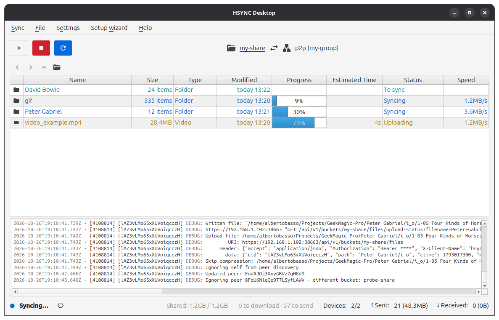
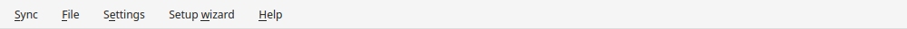
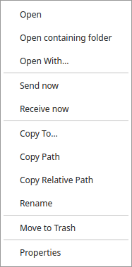
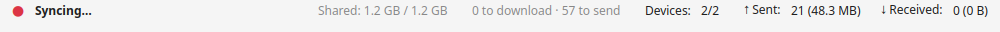
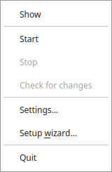

# A tour of the window

This page shows what you see when HSYNC Desktop is open, so the rest of the
documentation can refer to each part by name. You do not have to read it before
using the app — it is here to answer "what is that icon?".

## The menu bar

- **Sync** — start and stop a sync, preview the changes a sync would apply
  without starting one, check for changes, choose the sync direction.
- **File** — actions on the file or folder you selected (open, copy, rename,
  send/receive now, …).
- **Settings** — the configuration dialog; see the
  [Configuration Reference](configuration.md).
- **Setup wizard** — the guided setup for the common cases;
  see [Set up with the wizard](setup-wizard.md).
- **Help** — this documentation, the project on GitHub, the license and **About**
  (which shows the app version).

On macOS the same items live in the application menu, as usual on a Mac.

## The toolbar

The three buttons on the left are the everyday controls:

| Button | What it does |
| ------ | ------------ |
| ▶ **Start** | Begins syncing. A confirmation shows the plan before anything happens. To see that plan without starting a sync, use **Sync → Preview changes**. |
| ■ **Stop** | Stops the running sync; while it winds down the status shows `Stopping…` and the buttons stay disabled until it has exited. |
| 🔄 **Check for changes** | Re-compares your folder with the other devices and updates the list. It is disabled while a comparison runs; before a connection exists it explains that the check starts on its own. |

## The path bar

The path bar tells you **what** you are looking at and **where it goes**:

- the **folder icon** with the **share name** (here `my-share`) opens the shared
  folder in your file manager when you click it; the tooltip shows the folder's
  full path on this computer;
- the **⇄** and the remote icon with the connection (here `p2p (my-group)`) name
  the other side: a peer group in **p2p Mode**, or the server in **Server Mode**.

The **←**, **→** and **↑** arrows below the toolbar move through sub-folders, and
the folder button returns to the shared folder's root.

## The file list

The file list shows every file the sync is working on, one row each, with the
folder tree above it. Columns are resizable and reorderable; the header menu
toggles the optional columns and can reset the layout. Right-clicking a row opens
the actions for that file or folder. The full description is in
[The file list](file-list.md).

## The log panel

The **Log** panel at the bottom shows the sync engine's own messages while it
runs. You do not need it for normal use; it is the first place to look when
something does not work. The labels are explained in [Log Labels](log-labels.md),
and you can hide the panel from **Settings → General**.

## The status bar

The bottom bar answers, left to right:

- **Are we connected?** — the coloured dot and its label (`Connecting…`,
  `Syncing…`, `Stopping…`, `Connected`, …).
- **Is everything in sync?** — `All files in sync`, `2 to download · 1 to send`,
  `No devices`, `Checking…` and the other states described in
  [Warnings and notifications](warnings.md).
- **How big is the share?** — `Shared: X / Y`: **X** is this device's folder,
  **Y** is the whole share.
- **Who is taking part?** — `Devices: 2/2` in p2p Mode, or `Connected users` in
  Server Mode; in p2p Mode the primary/secondary role also appears here.
- **How much has moved?** — `↑ Sent` and `↓ Received` for this session (the count
  is of distinct files; the size in parentheses is the total bytes).

The bandwidth limits are editable straight from this bar: click the sent/received
labels.

## Closing the window and the tray

Closing the window **does not stop a running sync**: the app keeps working from
the system-tray icon. Use the tray menu to bring the window back (**Show**) or to
stop everything (**Quit**, which asks for confirmation while a sync runs). On a
desktop without a system tray, closing the window really closes the app (and
still asks before stopping a run).

## Where to go next

- [Your first sync](first-sync.md) — set up and run once, end to end.
- [Start, watch and stop a sync](sync-basics.md) — the everyday tasks.
- [Key concepts](concepts.md) — the words the app uses (share, group, primary…).
