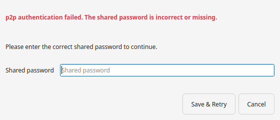

# Troubleshooting

Symptoms, what they mean, and what to try first. The warnings that appear while a
sync runs are explained in
[Warnings and notifications](warnings.md).

## A sync does not start

When the engine cannot start — or stops with a fatal error instead of syncing —
the app shows an error dialog with the reason the engine reported and writes the
same message to the log panel, instead of failing silently. One frequent reason is
the folder's instance lock: another `hsync` process is already syncing the same
folder (a terminal run, a scheduled job, an older process still running), and the
engine refuses to work beside it. Stop that process, or choose another folder.
Read the log line first; the labels it can contain are in
[Log Labels](log-labels.md).

Every line in the panel has the same shape —
`<timestamp> - [<pid>] [<source>] LEVEL: message` — where `<source>` is the
engine's device id or `[desktop]` for the app's own messages, and the timestamp
is UTC. Attach the whole panel (or the log file) to a bug report: one format
means one reading, whichever side wrote the line.

## A control is greyed out

Your sync engine does not support that feature — the tooltip names the option it
is missing. Update the app (every package ships a matching engine) and the control
becomes available.

## The file watcher degrades to polling (inotify limits)

The banner about the file watcher degrading to polling (or needing more watches or
instances) means the system ran out of the Linux inotify limits your user may hold.
The sync keeps running in a slower polling mode and the watcher recovers by itself
once the limits free up. The diagnosis commands and the per-platform remedy are in
the client guide:
[The file watcher degrades to polling (inotify limits)](https://github.com/albertsdk/hsync-client/blob/main/docs/troubleshooting.md#the-file-watcher-degrades-to-polling-inotify-limits).

The other warnings the app can raise during a sync (an unreachable discovery
server, low disk space, a folder that became unavailable) are listed in
[Warnings and notifications](warnings.md#warnings-during-a-sync).

## The window closed but the sync kept running

Closing the window hides it to the tray and a run continues. Use the tray menu to
show the window again, or **Quit** to stop the sync (the app asks for confirmation
first). Without a system tray the window really closes; see
[Start, watch and stop a sync → Start the app](sync-basics.md#start-the-app).

## Local files are about to be deleted

The **File Deletion Risk** prompt and the **Deletions skipped** warning are
explained in
[Warnings and notifications](warnings.md#warnings-before-a-sync), with the
acknowledgement that silences the prompt and the control that brings it back.

## Devices are not found in p2p Mode

- Every device must use the **same group name** (a device with no group only sees
  other no-group devices) and the **same share name** — see
  [Key concepts → Share](concepts.md#share).
- The devices must be on the same network, with mDNS allowed through the
  firewall.
- Devices on different networks need a **discovery servers** set in the p2p tab.
- If a discovery server is set but cannot be reached, the app warns you and keeps
  working on the local network — devices on this network are still found. The
  server only adds devices on *other* networks.
- A shared password is only needed to authorize writes.

## p2p authentication failed

A device you are syncing with requires a shared password that this device is
missing or has differently. The app stops and opens the password prompt so you can
enter the correct one (it is saved and the sync retries); the password must be
identical on every device in the group.

## The p2p password is rejected

The p2p tab field accepts a **shared password** (at least 12 characters; the
client derives the group key from it) or a **raw group key** (at least 32
characters). A shorter value is refused at startup. Generate a password with
`openssl rand -hex 16` and use the exact same string on every device in the group.
See [Secrets](secrets.md).

## A device's fingerprint changed, or pairing is required

These are the trust prompts; they appear when a device presents a new or changed
certificate. What to do is in
[Trust, fingerprints and identity checks](choose-trust.md).

## TLS errors in Server Mode

Verify the server address and its certificate. Enable **Skip certificate check**
only on a trusted network, for a self-signed server; for a permanent setup use the
**Certificate authority file** setting instead.

## Where are the logs?

The **Log** panel in the main window is the live view. To keep a file, set
*Settings → Advanced → Log file*; enable **Detailed log output** for verbose
lines. The action labels are documented in [Log Labels](log-labels.md).

## Advanced: from source and unusual platforms

- **Sync engine not found.** Packaged builds always bundle the engine, so this
  only happens in a source run: the GUI looks for the binary bundled in the build,
  on `PATH`, or in `../hsync-client/dist/<os>-<arch>/`. Build the client from the
  sibling checkout or install it so it is on `PATH` — see
  [From source](getting-started-source.md).
- **The Windows build does not start under Wine.** The console shows
  `err:module:import_dll Library icuuc.dll … not found`, followed by
  `Qt6Core.dll … not found`. Nothing is missing from the download: the Qt runtime
  in the Windows build links against the ICU library that ships with Windows, and
  Wine/CrossOver does not provide it, so the process stops before the app starts.
  Use a Windows 10 (version 1809 or later) or Windows 11 x64 host, or install the
  native package for your system — see [Getting Started](getting-started.md).

## Getting help

- [Support](../SUPPORT.md) — where to ask and what to include.
- [Open an issue](https://github.com/albertsdk/hsync-desktop/issues) with the log
  excerpt, your OS and the app version (**Help → About**).
- The client's
  [troubleshooting guide](https://github.com/albertsdk/hsync-client/blob/main/docs/troubleshooting.md)
  covers the sync-engine behaviour behind the GUI.
